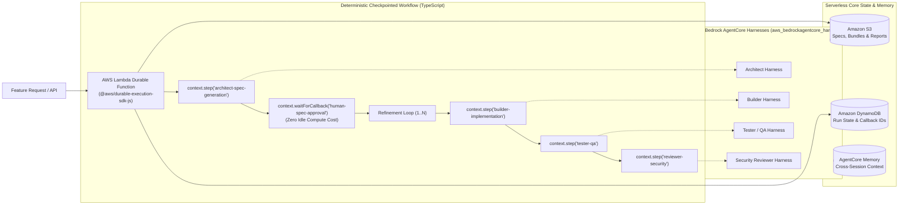

# AWS Bedrock AgentCore Harness — Software Factory

An enterprise **Software Factory** reference repository built on AWS's **Amazon Bedrock AgentCore Harness** blueprint, orchestrated with **AWS Lambda Durable Functions** (TypeScript) instead of Step Functions, provisioned with **Terraform**, and managed as a **Mise** monorepo.

---

## Architecture Overview



### Why AWS Lambda Durable Functions Instead of Step Functions?
Traditional AWS blueprints use AWS Step Functions (ASL JSON/YAML state machines) for the deterministic outer loop. This repository replaces Step Functions with **AWS Lambda Durable Functions** (`durable_config` on `aws_lambda_function` + `@aws/durable-execution-sdk-js`):
- **Pure TypeScript `async/await` DX**: Loops, retries, conditionals, and error handling are written in standard TypeScript (`packages/orchestrator/src/durable-workflow.ts`) using `context.step()`, `context.wait()`, and `context.waitForCallback()`.
- **Automatic Checkpointing & Replay**: Completed steps are checkpointed automatically; when a function resumes from a human-in-the-loop gate or retries after a transient error, prior steps replay instantly from checkpoints without re-invoking Bedrock.
- **Zero-Idle-Cost Human Approvals**: `context.waitForCallback("human-spec-approval", ...)` suspends the Lambda execution completely (incurring \$0 compute cost) until `SendDurableExecutionCallbackSuccess` is received.
- **Instant Local Testing**: The `LocalDurableTestRunner` tests multi-step agent refinement loops and callback suspensions in milliseconds locally without deploying to AWS.

---

## Monorepo Layout

```text
.
├── mise.toml                         # Root Mise config (tools: node, pnpm, terraform + monorepo tasks)
├── pnpm-workspace.yaml               # pnpm workspace configuration
├── package.json                      # Workspace scripts and shared devDependencies
├── tsconfig.base.json                # Shared strict TypeScript compiler configuration
├── packages/
│   ├── core/                         # Zod schemas, S3/DynamoDB state store, AgentCore Harness client
│   │   ├── mise.toml
│   │   └── src/
│   ├── orchestrator/                 # AWS Lambda Durable Function workflow, local test runner & simulator
│   │   ├── mise.toml
│   │   ├── scripts/bundle.mjs        # Bundles dist/orchestrator.zip for Terraform deployment
│   │   └── src/
│   └── tools/                        # AgentCore Harness tool handlers (read/write S3 artifacts, DDB state)
│       ├── mise.toml
│       ├── scripts/bundle.mjs        # Bundles dist/tools.zip for Terraform deployment
│       └── src/
└── infra/                            # Modular Terraform infrastructure (hashicorp/aws >= 6.25.0)
    ├── mise.toml
    ├── main.tf                       # Instantiates storage, memory, 4 specialist harnesses & durable lambda
    ├── variables.tf
    ├── outputs.tf
    ├── versions.tf
    └── modules/
        ├── storage/                  # S3 artifacts bucket + DynamoDB state table
        ├── memory/                   # aws_bedrockagentcore_memory + IAM role
        ├── agent-harness/            # Reusable aws_bedrockagentcore_harness module + inline tool schemas
        └── durable-orchestrator/     # aws_lambda_function with durable_config + AWSLambdaBasicDurableExecutionRolePolicy
```

---

## Quickstart with Mise

### 1. Install Tools & Dependencies
```bash
mise install
mise run install
```

### 2. Simulate the Software Factory Workflow Locally
Run a full multi-agent Software Factory pipeline locally (including simulated Attempt 1 QA failure and automatic Attempt 2 self-healing):
```bash
mise run factory:simulate
```

### 3. Run Unit & Durable Replay Tests
```bash
mise run test
```

### 4. Build TypeScript Packages & Lambda Bundles (`.zip`)
```bash
mise run build
```

### 5. Format, Validate, and Deploy Terraform Infrastructure
```bash
mise run tf:fmt
mise run tf:validate
mise run tf:plan
# Deploy to AWS:
mise run tf:apply
```
